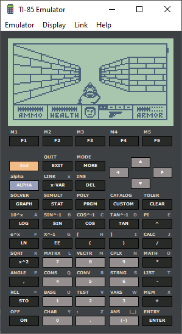

# TI-85 Emulator for Visual Basic 6

A pure VB6 TI-85 emulator with a scalable calculator interface, LCD
rendering, full emulator state save/load, link transfers, themes and
support for custom ROM images.

No third-party ActiveX/OCX components are used. File dialogs use the
included `CommonDialog.cls` wrapper (Win32 API).



## Requirements

- Microsoft Visual Basic 6
- Windows (32-bit VB6 runtime)
- A TI-85 ROM image (`.ROM`, `.BIN` or similar)

## Files

| File | Purpose |
|---|---|
| `Ti85EmuVB6.vbp` | VB6 project file |
| `Ti85EmuVB6.vbw` | VB6 workspace layout |
| `frmMain.frm` | main window, menus, keypad and emulation loop |
| `frmMain.frx` | binary form data (window/application icon) |
| `Res\AppIcon.ico` | source icon used for the form and the `.exe` |
| `UCTi85Btn.ctl` | TI-85 key button user control |
| `UCTi85LCD.ctl` | 128 x 64 LCD renderer and screenshot writer |
| `CTi85Layout.cls` | scalable layout and zoom handling |
| `CTi85Config.cls` | INI settings, ROM path, state path and window state |
| `CTi85Theme.cls` | button and LCD colour themes |
| `modMain.bas` | entry point and global `MainConfig`/`MainLayout`/`MainTheme` |
| `modTi85.bas` | memory, ROM loading, ports, keypad, LCD and state files |
| `modCPU.bas` | Z80 CPU core |
| `modLink.bas` | TI-85 link emulation and PC file transfer |
| `CommonDialog.cls` | Win32 open/save dialog wrapper (do not modify) |
| `Ti85EmuVB6.RES` | embedded `CUSTOM` resource fallback |
| `Roms\` | TI-85 factory ROM images |
| `CustomRom\` | BMP to custom ROM builder and example files |

Runtime files (created automatically as needed):

| File | Purpose |
|---|---|
| `TI85.INI` | theme, LCD, ROM path, state path and window position |
| `TI85.STATE` | full emulator state saved on exit |
| `link\receive\` | received link files |

## Build

Open `Ti85EmuVB6.vbp` in Visual Basic 6 and press F5, or compile it with
VB6 (File -> Make Ti85EmuVB6.exe).

Command-line build from the project folder:

```powershell
Get-Process Ti85EmuVB6,VB6 -ErrorAction SilentlyContinue | Stop-Process -Force
& "VB6.EXE" /MAKE ".\Ti85EmuVB6.vbp" /OUT ".\build.log"
Start-Sleep 5
Get-Content ".\build.log"
```

Use the VB6 executable available on your system if `VB6.EXE` is not on
`PATH`.

Expected result:

```text
Build of 'Ti85EmuVB6.exe' succeeded.
```

If VB6 reports that the project is already open, close the VB6 IDE or
kill `VB6.EXE` before rebuilding.

## Running

Start `Ti85EmuVB6.exe`. On the first run there is no `TI85.STATE` file, so
the calculator starts with the LCD off; press the on-screen ON key.

On later runs the emulator loads `TI85.STATE` automatically, restoring the
previous CPU, memory, ports and screen state. The window position and
size are also restored from `TI85.INI`.

The interface can be resized or maximized. The keypad and LCD scale
together while preserving the original aspect ratio. **Display -> Zoom**
offers 100%, 150%, 200%, 250% and 300%.

## ROM files and configuration

Settings are stored in `TI85.INI`:

```ini
[Ti85Emu]
ThemeName=DARK
LCDName=BLUEONGREEN
RomFilePath=.\Roms\ti85v100.bin
StateFilePath=.\TI85.STATE
FirstTime=0
WndTop=...
WndLeft=...
WndWidth=...
WndHeight=...
```

Paths may be relative to the emulator folder or absolute on the local
machine. Defaults when a key is missing:

| Key | Default |
|---|---|
| `RomFilePath` | `App.Path\TI85.ROM` |
| `StateFilePath` | `App.Path\TI85.STATE` |
| `ThemeName` | `DARK` |
| `LCDName` | `BLUEONGREEN` |

Use **Emulator -> Load ROM File...** to select a ROM at runtime. That
updates `RomFilePath`, loads the ROM and resets the calculator.

`Roms\` contains several 128 KB factory ROM images, including
`ti85v100.bin`. The project root also contains `TI85.ROM`.

If `RomFilePath` is missing or invalid, `Ti85LoadRom` falls back to the
embedded `CUSTOM` resource (id 101) in `Ti85EmuVB6.RES`. The current
embedded fallback contains the old text custom ROM, not a factory ROM.
Use a valid ROM path for the factory ROM.

## State files

The emulator has a full state save/load system.

- **Emulator -> Save State As...** saves the current state to a `.STATE` file.
- **Emulator -> Load State...** resets the ROM then loads a state file.
- On exit, the current state is saved automatically to `StateFilePath`
  (default `App.Path\TI85.STATE`).
- On startup, the state file is loaded automatically after `Ti85LoadRom`
  and `Ti85Reset`. If it is missing or invalid, startup continues normally.

State data includes:

- all 64 KB of `MEM` (RAM and LCD memory)
- all Z80 registers, flags and interrupt state
- port state: `VidOffset`, `KeypadMask`, `DisplayContrast`, `Port3`,
  `PowerReg`, `WasInterrupt`
- keypad matrix and `OnPressed`
- current ROM bank and cycle/timing counters

The state file does not include the ROM image itself or in-flight link
protocol buffers. Load State first reloads the configured ROM and resets,
then applies the state.

State file API in `modTi85.bas`:

```vb
Public Function Ti85StateSave(ByRef pFileName As String) As Boolean
Public Function Ti85StateLoad(ByRef pFileName As String) As Boolean
```

Format: magic `TI85ST01`, version 1, then `MEM`, CPU state and port state.
Current size is 65,708 bytes. Call these functions between CPU `Execute`
calls, not while `modCPU.Execute` is running.

## Controls

The on-screen keypad contains all 50 TI-85 keys. Click or hold a key; the
emulator automatically releases mouse-held keys after about 200 ms.

The four arrow buttons above the number pad are the cursor keys.

ON is the bottom-left button. It is handled specially by the emulator and
is not part of the normal keypad matrix.

Keyboard shortcuts from older versions are currently disabled (the
`Form_KeyDown`/`HandleKey` code is commented out). Use the on-screen
keypad. F12 is the menu shortcut for **Display -> Capture Screen**.

## Menus

### Emulator

- Load ROM File...
- Save State As...
- Load State...
- Reset
- Exit

Reset asks for confirmation because it clears memory. It resets the
emulated calculator but does not load a different ROM or a saved state.

### Display

- Zoom -> 100%, 150%, 200%, 250%, 300%
- Buttons -> Dark / Light
- Screen -> Blue/Green, Brown/Orange, Green/Black, Black/White, White/Black
- Capture Screen (F12)

### Link

- Send File...
- Receive File...
- Cancel Transfer

### Help

- About

## Display and screenshot

The LCD is 128 x 64 pixels. Screen memory is 1024 bytes, 16 bytes per row,
with bit 7 as the leftmost pixel. The video base is normally `&HFC00`.

`UCTi85LCD.ctl` renders the LCD into a 136 x 72 32-bpp DIB (128 x 64 plus a
4-pixel border), then scales it with `StretchDIBits`. It blanks the panel
when the display is off. LCD contrast comes from the emulated hardware
`DisplayContrast` value (port 2).

Use **Display -> Buttons** and **Display -> Screen** to change the theme.
The chosen theme names are stored in `TI85.INI`.

**Display -> Capture Screen** writes a 32-bpp BMP named
`yyyy-MM-dd-hh-mm-ss.bmp` next to the executable. The BMP header is written
with the correct pixel offset (54).

## Link transfers

- **Send File...** sends a `.85b`, `.85s`, `.85p` or other `.85?` file.
- **Receive File...** arms the receiver before sending from the calculator.
- **Cancel Transfer** aborts the current transfer.

To send, choose a file, put the calculator in receive mode
(2nd -> LINK -> RECV), then click OK. For a `.85b` backup the calculator
shows WARNING Memory Backup; select CONT. A backup replaces the
calculator's memory.

To receive, press 2nd -> LINK on the calculator, choose SEND, select the
variables and press XMIT. By default the emulator starts receiving
automatically when the calculator begins sending. To require the Receive
File menu command instead, set `LINK_AUTO_RECEIVE = False` in
`modLink.bas`.

Received files are saved in `link\receive`. A single variable keeps its
name and type extension (`.85s`, `.85p`, ...), multiple variables are saved
as `.85g`, and system backups as `.85b`.

Only the two-wire link and the PC side of the manual transfer protocol are
emulated; the TI-85 ROM performs the VAR/ACK/CTS/DATA/EOT packet protocol.

## Custom ROM and BMP converter

`CustomRom\` contains a formless VB6 project that converts a BMP image into
a monochrome TI-85 ROM with ON/OFF handling.

Usage:

```text
CustomRomBuilder.exe <input.bmp> [output.rom]
```

If the output path is omitted, it writes `CustomTI85.rom` next to the EXE.
The generated ROM is unpadded (currently 86-byte stub + 1024-byte image =
1110 bytes) and can be loaded with **Emulator -> Load ROM File...**.

The custom ROM:

- sets the LCD contrast to 18/32
- copies the image to the LCD buffer
- presses ON to blank the display
- presses ON again to restore the image

The converter supports uncompressed 1, 4, 8, 24 and 32 bpp BMP files.
Larger images are scaled down preserving aspect ratio; smaller images are
centred at 1:1. Conversion uses a fixed luminance threshold of 160.

`CustomTI85.asm` is reference source only; it is not assembled by the
generator. The VB6 project writes the machine code directly. See
`CustomRom\README.txt` for details.

## Known limitations and notes

- Keyboard shortcuts are currently disabled; use the on-screen keypad.
- CPU stop emulation for factory 2nd+ON power-off is not present in the
  current source. Custom ROM ON/OFF works by blanking the LCD and polling.
- If the ROM path is missing, the embedded fallback is the old text custom
  ROM, not a factory ROM.
- State files include MEM/CPU/ports but not the ROM image or in-flight link
  buffers.
- The state format is versioned (magic `TI85ST01`, version 1). Do not change
  the layout without bumping the version.
- VB6 source files must use CRLF line endings. LF-only `.vbp` files may
  cause modules to be ignored during compilation.
- This project is not a git repository. Use timestamped ZIP backups in the
  `backup\` folder.
- `Res\popo.mock` and `Res\popo.png` are user files; do not delete them.
- `CustomRom\download (3).bmp`, `download (9).bmp` and `download--.bmp` are
  user test images; do not delete them.

## Credits

TI-85 Emulator  
by EBArtSoft@  
Created with Microsoft Visual Basic 6  
AI assistance: DeepSeek V4.1 Flash

> [!IMPORTANT]
> Distributed VB6 executables may appear as viruses; simply let your antivirus software remove them and compile the project you need from Visual Studio. Never trust a .EXE from unknown source.

> [!CAUTION]
> The emulator's link receiver automatically downloads the files it receives; this feature may place files from unknown sources onto your computer.

> [!NOTE]
> This project does not claim to be a 100% realistic emulator. Its primary goal is to be simple, educational, and fun. Enjoy
